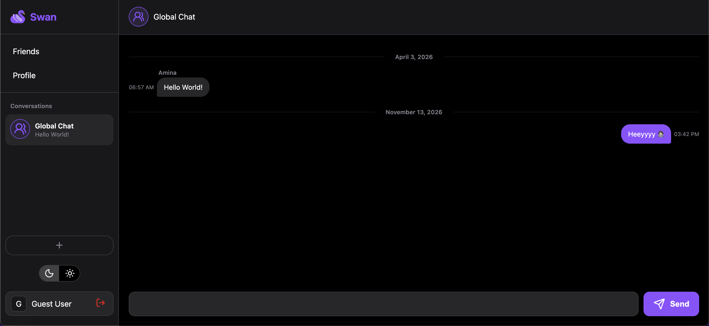

# 🦢 Swan

Swan is a full-stack real-time messaging application that allows users to connect and communicate through private conversations, group chats, and a shared global chat room.

Built with React, Node.js, Express, PostgreSQL, Prisma, and Socket.IO, Swan combines real-time communication with user authentication and conversation management.

<p align="center">
  <a href="https://amina-swan.vercel.app">Live Demo</a>
</p>

## 📸 Screenshots

|                  Conversations                  |                    Private Messaging                    |
| :---------------------------------------------: | :-----------------------------------------------------: |
|  |  |

|                 Global Chat                 |                     Group Conversations                     |
| :-----------------------------------------: | :---------------------------------------------------------: |
|  |  |

## ✨ Features

- **Authentication:** Secure user authentication with JWT and bcrypt password hashing.
- **Global Chat:** A shared chat room where all Swan users can communicate, regardless of their group memberships.
- **Private Conversations:** Real-time one-to-one messaging between users.
- **Group Conversations:** Create and participate in conversations with multiple members.
- **Friend Requests:** Send, receive, accept, and reject friend requests.
- **Conversation Roles:** Manage group permissions with OWNER, ADMIN, and MEMBER roles.
- **Read Status:** Track message read status within conversations.
- **Real-Time Communication:** Instant message delivery powered by Socket.IO.

## 🛠️ Tech Stack

| Frontend         | Backend   | Database & Deployment |
| :--------------- | :-------- | :-------------------- |
| React            | Node.js   | PostgreSQL            |
| Vite             | Express   | Prisma ORM            |
| React Router     | Socket.IO | Neon                  |
| Axios            | JWT       |                       |
| Socket.IO Client | bcrypt    |                       |
| Lucide React     |           |                       |
| CSS              |           |                       |

**Deployment:** Vercel (client) · Render (server) · Neon (database)

## 🗄️ Database Architecture

Swan uses PostgreSQL with Prisma ORM to manage its relational data.

### Models

- **User:** Stores user accounts and authentication information.
- **Conversation:** Represents private, group, and global conversations.
- **ConversationMember:** Manages membership and roles within conversations.
- **Message:** Stores messages and their associated conversations and senders.
- **FriendRequest:** Handles friend requests and their statuses.
- **ConversationRead:** Tracks when users last read a conversation.

### Enums

- **ConversationType:** `PRIVATE`, `GROUP`, `GLOBAL`
- **MemberRole:** `OWNER`, `ADMIN`, `MEMBER`
- **FriendRequestStatus:** `PENDING`, `ACCEPTED`, `REJECTED`

## 🚀 Getting Started

Follow these steps to run Swan locally.

### Prerequisites

- Node.js
- npm
- PostgreSQL database

### 1. Clone the repository

```bash
git clone https://github.com/AminaAssouane/messaging-app.git
cd messaging-app
```

### 2. Install dependencies

Install the client dependencies:

```bash
cd client
npm install
```

Install the server dependencies:

```bash
cd ../server
npm install
```

### 3. Configure environment variables

Create a `.env` file in both the `client` and `server` directories.

**Client — `client/.env`**

```env
VITE_API_URL=http://localhost:3000
```

**Server — `server/.env`**

```env
DATABASE_URL="your_postgresql_connection_string"
JWT_SECRET="your_jwt_secret"
```

### 4. Set up the database

From the `server` directory, generate the Prisma client and run database migrations:

```bash
npx prisma generate
npx prisma migrate dev
```

### 5. Start the backend

From the `server` directory:

```bash
node src/app.js
```

The backend runs on `http://localhost:3000`.

### 6. Start the frontend

Open another terminal, navigate to the `client` directory, and run:

```bash
npm run dev
```

Open the local URL provided by Vite, usually `http://localhost:5173`.

## 🔐 Environment Variables

| Variable       | Description                    | Location |
| :------------- | :----------------------------- | :------- |
| `VITE_API_URL` | Backend API URL                | Client   |
| `DATABASE_URL` | PostgreSQL connection string   | Server   |
| `JWT_SECRET`   | Secret used to sign JWT tokens | Server   |

**Note:** The backend currently listens on port `3000`.

## 💡 Motivation

I built Swan to deepen my understanding of real-time communication and full-stack application development.

The project gave me hands-on experience with WebSockets, authentication, relational database design, and managing different types of conversations in a single application.

## 👩‍💻 Built By

**Amina Assouane**

[GitHub](https://github.com/AminaAssouane) · [Portfolio](https://amina-assouane.vercel.app)
